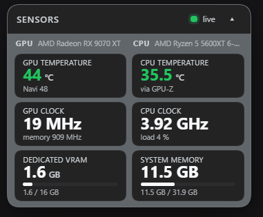
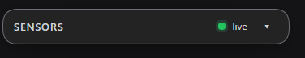

# DSH Local Monitor

A floating, draggable sensor dashboard for the **DeepSeek Harness** Web UI:
GPU readings from **GPU-Z** on the left, CPU and system memory on the right.

Six live cards in one compact window:

| Left column — GPU | Right column — CPU |
| --- | --- |
| GPU temperature | CPU temperature |
| GPU clock | CPU clock |
| Dedicated VRAM in use (with a /16 GB bar) | System memory in use (with a /32 GB bar) |

The window can be dragged anywhere by its title bar, remembers its position
across reloads, collapses to a single header row, and follows the app theme
(light and dark). Labels are **English by default**; French is used when the DSH
app locale is French, and either can be forced (see [Language](#language)).

## Screenshots



*Expanded: the six live cards, GPU on the left, CPU on the right.*



*Collapsed: the header alone. The chevron in the top-right corner expands and
collapses the window; hovering it shows "Collapse"/"Expand".*

## Features

- **Live by default** — the Host samples every second, the window refreshes
  every 1.5 s; a status dot shows *live* vs *offline*.
- **Real GPU-Z data** — reads the `GPUZShMem` shared-memory block GPU-Z
  publishes while it runs (the exact numbers of its *Sensors* tab), no OCR and
  no screen scraping.
- **Floating and draggable** — rendered into the frame-wide `shell.overlay`
  slot, so it sits above every column without stealing clicks elsewhere.
- **Theme-aware** — every colour is a Harness theme token, so it reads correctly
  in light and dark themes.
- **No dependencies** — plain React from the browser module table, and a single
  long-lived PowerShell child on the Host side.

## Data sources

| Value | Source |
| --- | --- |
| GPU temperature, GPU clock, dedicated VRAM used / total, card name | GPU-Z shared memory (`GPUZShmem`) |
| CPU temperature | GPU-Z's `CPU Temperature` sensor when it publishes one; otherwise the ACPI thermal zone (labelled "motherboard zone") |
| CPU clock and load | Windows performance data (`Win32_PerfFormattedData_Counters_ProcessorInformation`) |
| System memory in use | `GlobalMemoryStatusEx` |

## Requirements

- **Windows 10/11** — the collector uses the Windows sensor APIs.
- **GPU-Z running** — download it from [TechPowerUp](https://www.techpowerup.com/gpuz/).
  If GPU-Z is not running, the GPU column shows *"GPU-Z not found"* and the rest
  keeps working.
- **DeepSeek Harness** with a web profile.

## Install

From a local checkout:

```powershell
dsh plugin --profile web add link:D:\path\to\dsh-local-monitor
```

From GitHub:

```powershell
dsh plugin --profile web add github:astelirons-ai/dsh-local-monitor
```

Then reload the Web UI (`Ctrl+Shift+R`). The window appears near the top-right
corner of the frame and can be dragged from there.

## How it works

```
GPU-Z (shared memory)  ─┐
Windows CPU / memory   ─┼─> helper.ps1 (persistent child) ──> Host route
                        │        one JSON line per second      GET /dsh-local-monitor/sensors.json
                        └─────────────────────────────────────> client.js polls it
                                                                and renders shell.overlay
```

- `index.js` (Host) spawns `helper.ps1`, parses its JSON lines, keeps the latest
  sample in memory and exposes it as read-only JSON on
  `/dsh-local-monitor/sensors.json`. The route accepts loopback, same-origin
  requests only. The child is restarted automatically if it exits.
- `helper.ps1` runs one sampling loop: GPU-Z shared memory, CPU temperature and
  clock, physical memory. One JSON object per line on stdout.
- `client.js` (browser) registers a `shell.overlay` entry (`id:
  dsh-local-monitor`) and polls the route.

## Tuning

Three constants at the top of `client.js`:

```js
var WIDTH = 221    // window width in CSS pixels
var VSCALE = 0.45  // vertical density: 1 = original height, 0.45 = 55% shorter
var FSCALE = 0.7   // glyph scale, applied to every font size
```

`VSCALE` only compresses the vertical furniture (paddings, gaps, line heights,
card height). `FSCALE` shrinks the type, which is what keeps the labels inside
narrow columns; lower it when you make the window much narrower, raise it if the
labels feel too small.

The sampling interval lives in `helper.ps1` (`$intervalMs = 1000`) and the poll
interval in `client.js` (`POLL_MS = 1500`).

## Language

Labels ship in English and French. The window picks French when the DSH app
locale is French, English otherwise. To pin one language regardless of the app
locale, run this once in the browser console (DevTools) and reload the page:

```js
localStorage.setItem('dsh-local-monitor.lang', 'fr')   // or 'en'
```

Remove the override with `localStorage.removeItem('dsh-local-monitor.lang')`.

## Troubleshooting

| Symptom | Fix |
| --- | --- |
| Window does not appear | Reload with `Ctrl+Shift+R`; check the plugin is enabled in Settings → Plugins. |
| GPU column shows "GPU-Z not found" | Start GPU-Z (it may stay minimized in the tray). |
| CPU temperature says "motherboard zone" | GPU-Z is not publishing its CPU sensor on this machine; the value then comes from the ACPI zone and is approximate. |
| Numbers frozen on screen | The status dot shows *offline* when the Host has no fresh sample: check that `powershell.exe` can start and that GPU-Z is alive. |
| Nothing at all / route 404 | The Host half failed to load — check the Host log for `dsh-local-monitor`. |

To inspect the raw payload while debugging:

```powershell
Invoke-RestMethod http://127.0.0.1:3080/dsh-local-monitor/sensors.json | ConvertTo-Json -Depth 5
```

## Uninstall

```powershell
dsh plugin --profile web remove dsh-local-monitor
```

## License

MIT — see [LICENSE](LICENSE).
